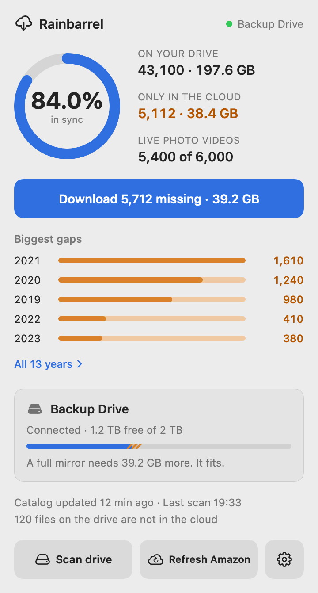
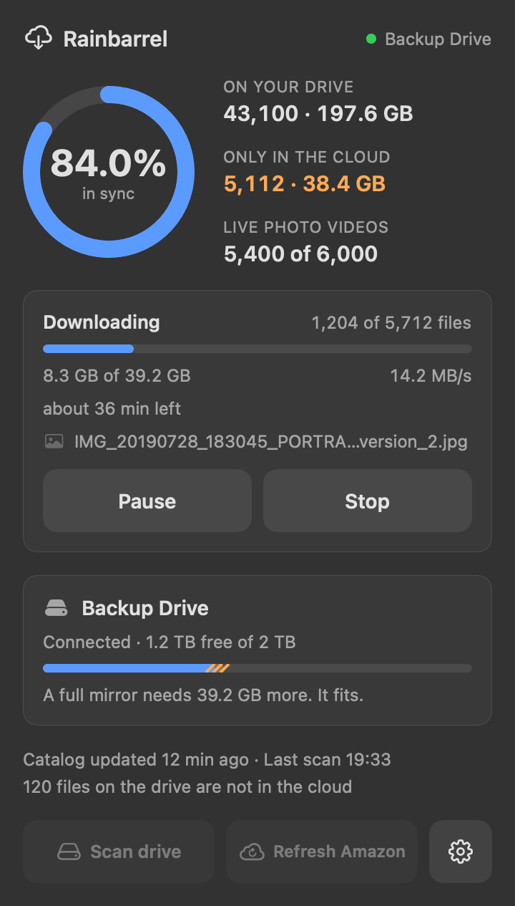
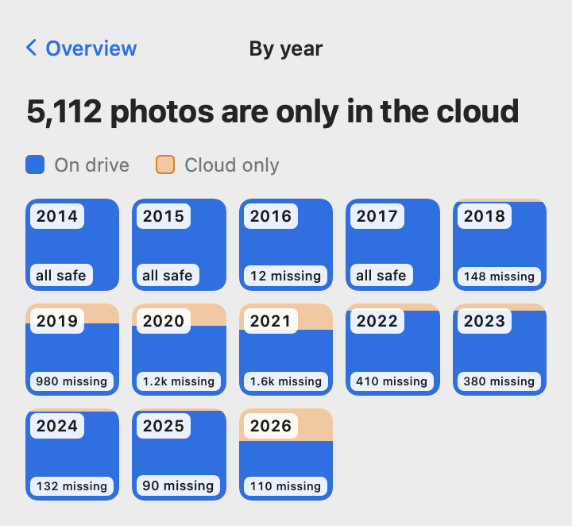

<p align="center"></p>

# Rainbarrel for Amazon Photos

[](https://github.com/eugertjani-lab/rainbarrel-for-amazon-photos/actions/workflows/ci.yml)
[](https://github.com/eugertjani-lab/rainbarrel-for-amazon-photos/releases/latest)

A verified local copy of your Amazon Photos library on your own drive.

<p align="center">
  
  &nbsp;
  
  &nbsp;
  
</p>
<p align="center"><sub>The menu-bar app with made-up demo data. Left to right: the overview, a download in dark mode, and the year map.</sub></p>

Rainbarrel is a free, open-source Mac app (with a command line tool that also runs on Linux) for people who keep their photos in Amazon Photos and want a complete copy at home that they can trust. It answers one question exactly: which of my photos and videos are safely on my drive, and which exist only in the cloud? Then it closes the gap.

- It compares your Amazon Photos library with a backup drive by MD5 checksum, so it knows a file is backed up because its content matches, whatever its name or folder.
- It downloads what is missing into the same folder layout you have in Amazon Photos, checks every file by MD5 before counting it, and never overwrites or deletes anything on the drive.
- It moves copies you already have (from an old backup or the Amazon Drive desktop sync) into that layout instead of downloading them again.
- It shows your library by year, including Live Photo videos, so gaps such as a phone that never synced stand out.
- It can tidy Amazon Photos itself through reviewed plans, for example trashing files that were uploaded empty: every change is listed before anything is sent, applied in small batches, checked afterwards and can be undone. It never empties Amazon's trash.
- It runs quietly in the menu bar, signs in to Amazon in its own window, pauses and resumes downloads, and keeps to gentle request limits.

It is free under the MIT License, and your library never passes through anyone else's server: Rainbarrel talks only to Amazon, with your own session, from your own Mac.

Rainbarrel for Amazon Photos is an unofficial community project and is not affiliated with, endorsed by or supported by Amazon (see the [disclaimer](#disclaimer)). In short contexts, such as the app, the command line tool and the MCP server, it is called just Rainbarrel. The name is a picture of what it does: a rain barrel catches what falls from the cloud and keeps it at home, and it only fills.

Rainbarrel is a Swift package with three front ends on one shared library: a command line tool called `rainbarrel`, an MCP server (`rainbarrel mcp`) that lets an AI assistant ask about your backup, and a macOS menu-bar app. Rainbarrel compares the photos and videos in your Amazon Photos account with the files on a backup drive, by MD5, and reports which items are backed up, which exist only online and which exist only on the drive. It can then download the missing items to the drive, check every file by MD5 and add it to the backup (see [Downloads](#downloads)). The Amazon Photos desktop app is optional: without it, Rainbarrel reads the library through Amazon's web API with your own signed-in session. In the menu-bar app you sign in to Amazon in a built-in window and start, pause and resume downloads from the panel.

## Disclaimer

Rainbarrel for Amazon Photos is an unofficial community project. It is not affiliated with, endorsed by or supported by Amazon. "Amazon" and "Amazon Photos" are trademarks of Amazon.com, Inc. or its affiliates.

The tool reads the catalog of your library either from the local index database that the Amazon Photos desktop app keeps on your computer or from Amazon's private web API. The index file is an internal detail of the app, so Amazon can change its location or format at any time, and Rainbarrel may stop working without notice. Reading the catalog from the web API, downloading and changing the library (see [Changing Amazon Photos](#changing-amazon-photos)) all talk to that API with your own signed-in session, an interface that Amazon has not published for third parties and can change or block at any time, possibly without notice. Amazon's terms of use may restrict automated access. Rainbarrel is intended for backing up your own account only, with conservative request limits by default. Use it at your own risk, and keep more than one copy of anything you care about.

## How it works

Rainbarrel reads the catalog of your library (names, sizes, dates and MD5 checksums) from one of two sources, and the Amazon Photos desktop app is optional.

### The desktop app's index

The Amazon Photos desktop app for Mac keeps a SQLite catalog of your whole library (names, sizes, dates and MD5 checksums) in `~/Library/Application Support/Amazon Cloud Drive/`. The app has that database open and writes to it, so Rainbarrel never opens the original. Each refresh copies the database together with its `-wal` and `-shm` files into a private temporary folder, reads the copy and deletes it afterwards.

### Amazon's web API

Without the app, or when you choose it, Rainbarrel reads the library through Amazon's private `/drive/v1` web API, using the session that downloads use as well (see [Signing in](#signing-in)). The first read drains Amazon's change feed from the beginning. The feed delivers every node of the account's history in order, up to 10,000 nodes per request, and a node that changed since it first appeared comes again, so the last word about each node wins. Rainbarrel keeps the available photos and videos, the available Live Photo videos and the available folders, and drops everything else, trashed and purged nodes included. It keeps to the request limit in `throttle.maxRequestsPerMinute`, so a large library takes a while, and it waits and retries when Amazon answers 429 or a 5xx status. A change-feed call waits up to three times as long for its answer as other calls do, because 10,000 nodes are about 14 MB. Photos and videos that Amazon delivers without an MD5 or a size cannot be compared and are left out; the refresh reports how many there were. At the end, Rainbarrel asks Amazon how many photo and video files the account has and compares that with what it stored. A difference is reported as a warning and the catalog is kept, because uploads can land while the refresh runs.

The position in the change feed where the drain ends is stored in `state.sqlite` together with the source and the Amazon host. A position taken before the drain would be an early one, and continuing from it would replay the whole library. Later refreshes ask the feed for what changed since the stored position, which takes a few requests: new and changed items are stored, and trashed or purged ones are removed. `rainbarrel catalog refresh --full` reads everything again, and Rainbarrel does the same by itself when the feed asks for a rebuild or when the stored position belongs to another source or host. A web refresh either completes or leaves the previous catalog as it was, and it refuses to run while a download is running, because the download works from that catalog.

### Choosing the source

`rainbarrel config set-catalog-source auto|app|web` sets `catalogSource` in `config.json`. The default, `auto`, uses the desktop app's index when it is found and the web API otherwise. `rainbarrel catalog refresh --source app|web` overrides the choice for one refresh, and the MCP tool `refresh_catalog` takes the same `source` argument. Changing the source makes the next web read start with a full listing. `rainbarrel status` and the `sync_status` tool say which source produced the catalog and when.

### Comparing with the drive

The catalog rows are copied into Rainbarrel's own database (`state.sqlite`). The backup drive is indexed the same way: a scan walks the drive, records the size and modification time of every file and computes an MD5 for each file that is new or has changed. Files that are already hashed are not read again. Scanning only ever opens the drive for reading. Two commands write to the drive: `rainbarrel download`, which adds missing files, and `rainbarrel organize`, which moves files that are already there into the same folder layout. Both are described below.

A comparison by MD5 then gives these categories:

- In sync: a cloud photo or video whose MD5 matches a hashed file on the drive. One copy on the drive satisfies every cloud item with that MD5, so duplicates in the cloud do not show up as missing.
- Online only: a cloud photo or video with no matching file on the drive.
- Drive only: a hashed file on the drive whose MD5 is in neither the photo and video catalog nor the Live Photo video catalog.
- Live Photo videos: the video half of a Live Photo is reported as its own category with the same in sync and online only split, and is not included in the photo and video totals.

Empty files are ignored in every comparison. Every 0-byte file has the same MD5 (`d41d8cd98f00b204e9800998ecf8427e`), so an empty file on the drive says nothing about an empty item in the cloud: a placeholder such as `.nomedia` or a lock file would otherwise "match" every broken zero-byte cloud item. An empty drive file is never a copy of a cloud item and never counts as drive only, and an empty cloud item stays online only until a download creates it as an empty file at its Amazon path.

Years in the per-year table use the capture date from the catalog (the content date, or the creation date when there is none), interpreted as UTC. Trashed and purged items are ignored.

### Which drive files count

Only files inside the scan folder count. That folder is the drive root plus the optional scan subpath, for example `/Volumes/MyBackupDrive` plus `Amazon Photos Backup`. Index rows outside it are ignored by every report and removed by the next scan. Operating-system housekeeping is never indexed: `desktop.ini`, `Thumbs.db`, `.DS_Store`, files starting with `._`, and everything inside `$RECYCLE.BIN`, `System Volume Information`, `.Spotlight-V100`, `.fseventsd`, `.Trashes` and `.TemporaryItems`. The same rules apply to imported hash files, and rows that match them are removed on the next scan or import.

A scan that walks the whole scan folder also forgets files that have disappeared from the drive. It only does so when a successful folder listing proves the file is gone: either the file's own folder was listed without it, or an ancestor folder was listed without the sub-folder that contained it. A folder whose listing failed, even after the retries described below, never causes anything to be forgotten, so a drive that drops out cannot make real backups look missing. Scans that stop early (a file limit, or Stop in the app) never forget anything.

### Flaky drives

Some drives, for example NTFS volumes mounted through macOS's FSKit driver, drop out briefly and answer with "Input/output error", "Device not configured" or a spurious "No such file or directory". The scanner retries every directory listing and every file read up to five times, waiting 2, 4, 6, 8 and 10 seconds, before it records the error for that file and moves on. The next scan retries files that failed.

### Several programs at once

The command line tool, the MCP server and the menu-bar app can all use the same `state.sqlite`. The database runs in WAL mode with a 5 second busy timeout, readers never block, and write transactions are short: a catalog refresh reads the catalog into a temporary table first and only swaps it into place in one quick transaction.

## Install

### Download the app

Download `Rainbarrel-<version>-macos.zip` from the [latest release](https://github.com/eugertjani-lab/rainbarrel-for-amazon-photos/releases/latest), unzip it and move `Rainbarrel.app` to your Applications folder. The release build is made on an Apple silicon runner and needs macOS 14 or later. Rainbarrel reads the catalog from the local index of the Amazon Photos desktop app when that app is installed and signed in on the same Mac, and from Amazon's web API otherwise (see [How it works](#how-it-works)).

The app is ad-hoc signed and is not notarized by Apple, so macOS asks for confirmation on the first launch. Right-click `Rainbarrel.app`, choose Open and confirm the dialog. Newer macOS versions may show a dialog without an Open button; in that case use Open Anyway under System Settings, Privacy & Security. Alternatively, remove the quarantine flag that the download added and open the app normally:

```sh
xattr -dr com.apple.quarantine /Applications/Rainbarrel.app
```

### Download the command line tool

Each release also carries `rainbarrel-<version>-macos-universal.tar.gz` (Apple silicon and Intel, macOS 14 or later) and `rainbarrel-<version>-linux-x86_64.tar.gz`. Unpack the archive for your system and put `rainbarrel` somewhere on your `PATH`:

```sh
tar -xzf rainbarrel-<version>-macos-universal.tar.gz rainbarrel
sudo mv rainbarrel /usr/local/bin/
rainbarrel --version
```

A binary downloaded with a browser carries the quarantine flag as well; `xattr -d com.apple.quarantine rainbarrel` clears it. The Linux build links the Swift runtime dynamically and the system SQLite, so it needs a Swift 6 runtime and `libsqlite3` on the machine.

Every release has a `SHA256SUMS.txt` file. To check the files you downloaded, run this in the folder that holds them:

```sh
shasum -a 256 -c SHA256SUMS.txt --ignore-missing
```

### Build from source

Install a Swift 6.1 or newer toolchain, clone the repository and follow [Requirements and build](#requirements-and-build). In short, `swift build -c release` produces `.build/release/rainbarrel`, and `scripts/build-app.sh` produces `build/Rainbarrel.app`.

## Requirements and build

- macOS 14 or later, with a Swift 6.1 or newer toolchain (Xcode or the open source toolchain). Swift 6.1 is needed because the MCP Swift SDK declares tools version 6.1.
- The Amazon Photos desktop app is optional. Without it, the catalog comes from Amazon's web API, which needs a session imported with `rainbarrel auth import` (see [Signing in](#signing-in)).
- Linux is a goal for the library, the command line tool and the MCP server, see the notes below.

```sh
swift build -c release
swift test
.build/release/rainbarrel --help
```

The command line binary is `.build/release/rainbarrel`. Copy it anywhere on your `PATH` if you like.

## Command line usage

```sh
# Tell Rainbarrel where the backup drive is. The optional subpath limits everything to one folder.
rainbarrel config set-drive /Volumes/MyBackupDrive --scan-subpath "Amazon Photos Backup"
rainbarrel config show

# Copy the cloud catalog into Rainbarrel: from the Amazon Photos app index when it is found,
# from Amazon's web API otherwise (that needs `rainbarrel auth import`, see Signing in).
rainbarrel catalog refresh
rainbarrel catalog refresh --source web --full   # pick the source for this run and read everything again
rainbarrel config set-catalog-source auto        # auto (the default), app or web

# Optional: import MD5s that another tool computed earlier, so they do not have to be recomputed.
rainbarrel import-hashes ~/hashes.csv --prefix "Amazon Photos Backup"

# Index the drive. Start with a quick metadata-only pass, then hash.
rainbarrel scan --no-hash --limit 2000
rainbarrel scan

# See how things stand.
rainbarrel status
rainbarrel status --json

# List the details.
rainbarrel online-only --year 2019 --limit 20
rainbarrel drive-only --limit 20 --json
```

`rainbarrel refresh-catalog` is the earlier name of `catalog refresh` and still works.

To fetch the missing files (details in [Downloads](#downloads)):

```sh
rainbarrel auth import ~/cookies.txt      # once, and again when the session expires
rainbarrel download --dry-run --limit 20  # print where files would go
rainbarrel download --limit 100           # download the newest 100 missing files
rainbarrel download-status                # queue, failures, session and limits
```

`status` refreshes the cloud catalog first when the last refresh is more than ten minutes old; add `--no-refresh` to skip that. `--limit` on `scan` stops the run after that many files needed work (new, changed or not hashed yet), and files that are already up to date do not count, so repeated limited runs keep making progress.

`rainbarrel sync` is a placeholder for the future download feature. It prints a message and exits with code 2.

Example output of `rainbarrel status` (the numbers are made up):

```
Rainbarrel status
  Catalog as of:          2026-01-15 09:12 (3 min ago)
  Catalog refreshed:      2026-01-15 09:14
  Drive:                  /Volumes/MyBackupDrive / Amazon Photos Backup
  Drive mounted:          yes
  Last drive scan:        2026-01-14 21:30

Cloud photos and videos
  Total:                  120,000  (610.00 GB), 118,500 distinct MD5s
  In sync (on drive):     96,000  (480.00 GB)  80.0%
  Online only:            24,000  (130.00 GB)

Live Photo videos (counted separately)
  Total:                  9,000  (45.00 GB)
  In sync (on drive):     7,000  (35.00 GB)
  Online only:            2,000  (10.00 GB)

Drive
  Hashed files:           97,500
  Drive only:             120  (350.00 MB)  (hashed, not in the cloud)
  Not hashed yet:         0
  With errors:            0
```

### Hash CSV format

`import-hashes` reads a CSV with the header `path,size,md5,result`. The `path` column is relative to `<driveRoot>/<prefix>`, fields may be quoted when they contain commas, and the `result` column is free text. Rows with an empty MD5 or a size of -1 are stored as errors without a hash. Imported rows count as hashed. On the next scan the scanner keeps their hash and only fills in the real modification time, as long as the file size still matches.

## Downloads

`rainbarrel download` fetches the photos and videos that exist only in the cloud and adds them to the backup drive. Every file is checked by MD5 against the catalog before it counts as backed up, nothing on the drive is ever overwritten or deleted, and the speed, the number of requests and the hours of the day are all limited by settings you control.

Downloads use Amazon's private web API with your own signed-in session. Amazon has not published that interface for third parties, so it can change or be blocked at any time, and Amazon's terms of use may restrict automated access. Rainbarrel keeps its requests slow by default, but any account that downloads a large library this way takes a risk. Use it at your own risk and only on your own account.

### How a download works

A run starts by building a queue (the `download_jobs` table in `state.sqlite`) from the online-only items, newest first, with the video half of Live Photos included unless you pass `--no-live-videos`. The first request of a run asks Amazon for one file of your catalog, which shows at once whether the session still works. Each file is then requested as `GET /drive/v1/nodes/{id}/contentRedirection`, sent with your session cookies and the `x-amzn-sessionid` header, which redirects to the original file. The body is streamed to a temporary file named `.<name>.rainbarrel-part` next to the final name while its MD5 is computed on the way. When the transfer ends, the size and the MD5 must equal the catalog values. The file is then flushed to disk, renamed to its final name in one step and only after that recorded in the drive index, so the next `status` already counts it as in sync.

A run continues where the last one stopped. Files that were interrupted by a crash or by Ctrl-C go back to the queue, and Ctrl-C ends the run after cleaning up the file in progress. Content that exists in several cloud items is downloaded once, and content that is already on the drive is skipped. Only one download runs at a time, because a lock file in the data folder keeps a second run away. When Amazon refuses a single file (an HTTP 401 answer) or answers with a web page instead of the file, Rainbarrel checks that the session still works. If it does, that one file is marked failed with the reason and counts one attempt, and the run goes on with the next file; only a failed session check stops the run and asks you to sign in again.

### Where files go

A file is written to `<drive>/<scan subpath>/<cloud folder path>/<file name>`, where the cloud folder path is the chain of folder names from the root of your Amazon Photos drive down to the folder that holds the file. A photo from the cloud folder `Pictures/Phone` ends up as `Amazon Drive/Pictures/Phone/IMG_0001.HEIC` when the scan subpath is `Amazon Drive`. If your drive already holds an older copy of the same tree, new files land next to the existing ones. The folder names come from the catalog, which `catalog refresh` reads together with the file list, from the app index or from the web API. The first download after an upgrade therefore refreshes the catalog by itself.

Files whose folder cannot be found go to `_Unsorted/<year>/<month>/` below the scan folder, using the capture date. The video half of a Live Photo is written next to its photo and named like the photo with the extension `.MOV` (`IMG_0004.HEIC` and `IMG_0004.MOV`), which is how Apple Photos pairs them. If that name is taken, the video becomes `IMG_0004 (2).MOV`.

Names from the cloud are cleaned before they touch the disk. The characters `/` and `:` become `_`, and so do the characters that NTFS and exFAT refuse (`\ * ? " < > |`), so a drive that is reformatted later accepts every name. Control characters are removed, a trailing dot or space is dropped, and `.`, `..` and an empty name become `_`. A name is cut to 255 bytes of UTF-8 with its extension kept. The final path is resolved and must lie inside the target folder, symbolic links included, before anything is written.

### What it never does

Rainbarrel never overwrites a file and never deletes anything except its own `.rainbarrel-part` temporary files. When the target name exists and the file has the same size and the same MD5 as the cloud file, the file is recorded as backed up without being downloaded again. When it differs, the new file gets a numbered name (`IMG_0001 (2).jpg`, `IMG_0001 (3).jpg`, and so on) and the existing file stays untouched. Temporary files that an earlier crashed run left behind are removed from the folders of the interrupted files and from every folder the run writes to, and nowhere else. A transfer whose MD5 or size is wrong is deleted at once and tried again, up to three times in one run and five times over several runs, after which the file is listed as failed in `download-status` with the reason. A file is never recorded as backed up before its checksum has matched.

### Throttling

All limits are in `config.json` under `throttle`, and `rainbarrel config set-throttle` changes them. The defaults are meant to be gentle.

| Setting | Default | Meaning |
| --- | --- | --- |
| `maxConcurrentDownloads` | 2 | Files downloaded at the same time, 1 to 8. |
| `maxRequestsPerMinute` | 60 | All calls to Amazon together, as a token bucket with a burst of five seconds' worth. |
| `maxBandwidthMBps` | 0 | Download speed over all files together; 0 means unlimited. |
| `pauseBetweenFilesMs` | 0 | Pause after each finished file, in each download slot. |
| `activeHours` | off | Local-time window such as `22:00-06:00` (it may cross midnight) in which new files are started. |
| `dailyLimitGB` | 0 | Stop starting files after this many gigabytes per local day; 0 means unlimited. |
| `minFreeSpaceGB` | 5 | A file that would leave less free space on the drive than this is not started. |

The limit of 8 parallel files is fixed. All download slots share the one request budget of `maxRequestsPerMinute` against Amazon's unpublished web API, so more than 8 files at once mostly adds request pressure and the risk of 429 throttling or of Amazon flagging the account. The drive and the network are already saturated well before that, and 8 keeps a run fast but still gentle.

```sh
rainbarrel config set-throttle --concurrency 1 --rpm 30 --mbps 2 --hours 01:00-06:00 --daily-gb 20
rainbarrel config set-throttle --hours off
rainbarrel config show
```

`download` accepts `--concurrency` and `--mbps` for one run. Outside the active hours a run waits until the window opens; `--respect-hours` makes it stop with a message instead, and `--ignore-hours` downloads anyway. Files that are already in progress when the window closes are finished.

When Amazon answers 429, 503 or another 5xx status, or the network fails, every download waits with an exponential backoff that starts at 5 seconds, grows to at most 300 seconds, uses full jitter, and lasts at least as long as the `Retry-After` header asks. After five such answers in a row the whole run pauses for 15 minutes and says so. An answer of 401 ends the run immediately with "Amazon session expired: sign in again" and is never retried.

An answer of 403 can also come from Amazon's request limits or bot defence while many files download at once, so it is not taken for an expired sign-in by itself. Rainbarrel first asks Amazon for the number of files in your account with the same session. When that call works, the 403 counts as one more throttle answer and follows the backoff described above. Only when Amazon refuses the check as well does the run end with the session message. Requests that get a 403 at the same moment share one check, and a successful check is reused for 30 seconds.

When the catalog is read from the web API, `maxRequestsPerMinute` limits the feed reads too, and a feed read backs off on 429 and 5xx answers in the same way, honouring `Retry-After`. After five such answers in a row the refresh stops with an error and keeps the previous catalog, instead of pausing for 15 minutes. The active hours and the daily limit apply to downloads only.

### Signing in

Downloads and the catalog read from the web API both need a session. In the menu-bar app, choose Sign in to Amazon: Amazon's own page opens in a window, and the session is kept in the macOS Keychain. The command line tool shares that session on the same Mac. On Linux, or without the app, sign in to Amazon Photos in a browser, export that site's cookies as a Netscape `cookies.txt` with a cookie export extension, and import them:

```sh
rainbarrel auth import ~/cookies.txt
rainbarrel auth status
rainbarrel auth logout
```

`auth import` also reads the JSON that Rainbarrel stores. It keeps only the cookies of the configured Amazon host's domain, drops expired ones and needs a `session-id` cookie, because Amazon expects its value again in the `x-amzn-sessionid` header. Delete the exported file afterwards, since it contains your session. `auth status` shows the host, when the session was saved and how many cookies it holds, and checks with one request for a known file whether Amazon still accepts it. On a fresh setup it prints "Not signed in".

Amazon renews some of the session cookies while it is in use, and Rainbarrel keeps the renewed ones. Every successful answer (status 200 to 399, redirects included) may carry new cookies of your Amazon domain. A new cookie replaces the old one with the same name, domain and path, and a cookie that arrives already expired removes it. Answers with an error status never change the session, and cookies of other sites are ignored. The next request already sends the renewed cookies. A download run or a catalog read writes them back to the stored session at most once a minute and once more when it ends, so the next run starts with them. The time of your sign-in, which `auth status` shows, stays as it was, and a session you have replaced by signing in again in the meantime is never overwritten by an older run.

When Amazon refuses the session in the middle of a download and the stored session has been replaced by a newer sign-in since the run began, for example in the menu-bar app or with `auth import` in another terminal, the run switches to the newer session and repeats the refused file instead of stopping. This happens once for each new sign-in, so a newer session that Amazon refuses as well still ends the run. In the menu-bar app, signing in again after a download stopped because the sign-in expired starts that download again by itself; it continues from the saved progress.

On macOS the session is kept in the Keychain (a generic password with the service `io.github.eugertjani-lab.rainbarrel.session` and the account `amazon`), so the menu-bar app can use the same item later. On Linux, and on macOS when the environment variable `RAINBARREL_SESSION_STORE=file` is set, it is kept in `session.json` in the data folder with permissions 0600, and a file that other users can read is refused. Cookie values are never printed or logged, and error messages have them removed. Cookies are sent only over https and only to hosts they belong to, and redirects are followed only over https to hosts under `amazon.com`, `amazonaws.com`, `cloudfront.net` and the registrable domain of your Amazon host. For another region, set `amazonHost` in `config.json`, for example `"amazonHost": "www.amazon.co.uk"`. A request waits at most 60 seconds for an answer (a change-feed call, 180 seconds), and a transfer is stopped when no bytes arrive for 120 seconds.

### Read-only drives

Before a run, Rainbarrel creates and removes a probe file called `.rainbarrel-write-test` in the target folder. If that fails, the run stops with "The backup drive is read-only (for example NTFS on macOS). Reformat it as APFS or exFAT, or choose another folder." That check happens before the session is read and before any network call. If the drive disappears during a run, the run stops cleanly and the files in progress stay in the queue.

### Trying it out

`rainbarrel download --dry-run --limit 20` prints where the next files would go and writes nothing. `rainbarrel download --to ~/rainbarrel-test --limit 3` downloads into another folder, laid out like the drive. A run with `--to` leaves the drive index and the queue alone, so those files are not counted as backed up.

## Moving an existing copy onto a new drive

A drive that was filled by a plain copy (for example 700 GB copied from an old NTFS partition into a new APFS one) holds the right files in the wrong folders. `rainbarrel organize` moves each file that matches a file in your Amazon Photos library to the place where `rainbarrel download` would have put it, so the drive ends up as if Rainbarrel had downloaded everything. Afterwards `rainbarrel download` only has to fetch what is really missing.

```sh
# 1. Copy the folder onto the new drive with Finder or rsync; the file names do not matter.
# 2. Point Rainbarrel at the new drive (the scan subpath is the folder the copy lives in).
rainbarrel config set-drive /Volumes/NewBackup --scan-subpath "Amazon Drive"
# 3. Read the catalog and index the new drive. This hashes every file once.
rainbarrel catalog refresh
rainbarrel scan
# 4. See what would move. Nothing is changed.
rainbarrel organize
# 5. Move the files. Add --limit 500 for a first small run, and --prune-empty-dirs to remove the folders it emptied.
rainbarrel organize --apply
# 6. Fetch whatever is still missing.
rainbarrel download
```

Without `--apply` the command prints a summary and a sample of moves and changes nothing. The summary counts the files to move (with how many go to `_Unsorted/<year>/<month>` because their cloud folder is unknown, and how many get a numbered name), the files already in place, extra copies, drive-only files, files that were skipped (with the reason) and the cloud files that are not on the drive at all. Paths are shown relative to the drive root.

Files are matched by MD5, using the hashes of the last scan. Organize never hashes anything itself, so it is quick, and it leaves a file alone when its size or modification time no longer matches the index (run `rainbarrel scan` again). The target comes from the same code as the downloads: `<scan folder>/<cloud folder path>/<file name>`, with the `.MOV` name for the video half of a Live Photo, the `_Unsorted` fallback, and the same name cleaning and path checks. Empty files are never matched or moved for the same reason (every empty file has the same MD5); the preview counts them on an "Empty files" line and they stay where they are. When the library holds the same bytes twice, one drive file satisfies one cloud item and the download engine's own duplicate handling decides whether more is needed; organize never copies a file.

If several drive files have the content of one cloud file, the one that is already at the target is kept, otherwise the one with the shortest path (then the first in alphabetical order) is moved, and the others are reported as extra copies and stay where they are. If the target name is taken by a file with the same MD5, the source is such an extra copy and stays. If it is taken by different content, the file gets a numbered name (`IMG_0001 (2).jpg`), like a download would. A file that matches nothing in the cloud (a drive-only file) is never touched, and neither is a file without a hash.

Every move is a rename(2) inside one volume. Nothing is copied, overwritten or deleted, and a file whose target lies on another volume is skipped and reported. The drive index follows each file (its path is updated, not rehashed), so `status` and the next scan stay correct. The same read-only check as for downloads applies: if the drive cannot be written to, `--apply` stops with the same message and changes nothing. Organize and a download never run at the same time, because both take the lock file `download.lock` in the data folder; the dry run only reads and is always allowed. Do not start a scan while an organize run is active, because the scan could drop the index rows of files that are being moved.

Each run is written to a journal (the `organize_moves` table in `state.sqlite`, with the folders the run created in `organize_dirs`), committed in small batches together with the moves. `rainbarrel organize --undo` reverses the last run: files go back to where they were and the folders the run created are removed again when they are empty. It refuses an entry whose file has changed since the move (different size or modification time), is gone, or whose old place is taken, reports it, and leaves it in the journal. A run that is interrupted by Ctrl-C finishes the file in progress and can simply be started again, because every run plans from the current state of the drive. If the process is killed hard between a rename and the commit of its batch, at most one batch of files is not in the journal; they are intact, and the next `scan` finds them at their new place.

`--prune-empty-dirs` removes, with `rmdir` only, the folders that the moves left empty and their parents that became empty because of that. It never touches a folder that was already empty before the run, a folder that still holds anything (a `.DS_Store` included), the scan folder itself, or anything above it.

## Changing Amazon Photos

Rainbarrel can also change your Amazon Photos library, and every change goes through a plan. A plan is an ordered list of steps that one planner worked out from the stored catalog, for example "move this empty file to Amazon's trash". Making a plan sends nothing to Amazon. The plan is a draft in the `amazon_plans` and `amazon_plan_steps` tables of `state.sqlite`, and you decide afterwards whether it runs. Changes use the same private web API and the same signed-in session as downloads, with the same risks (see the [disclaimer](#disclaimer)), so start with a small plan and look at the result on the Amazon Photos website.

The first planner finds the files that were uploaded empty. `rainbarrel plan cleanup-empty` refreshes the catalog when it is more than ten minutes old and creates a draft with one trash step for every photo or video of 0 bytes, and for every empty Live Photo video. Each step carries its reason ("empty file (0 bytes)") and a record of what the item looked like when the plan was made: its folder, its name, its status and its MD5. The command prints the plan id and a summary such as "Trash 192 items (0 B)".

### Reviewing a plan

`rainbarrel plan list` shows every plan with its status, which is draft, applying, applied, partly applied or undone. `rainbarrel plan show <id>` shows one plan with its counts, its bytes and its largest folders, and `--steps` adds the steps themselves with their reasons and results. Steps are grouped by operation and by folder path, so a review can tick or untick a whole folder, and a step that is unticked is never applied. The ticking is meant for the review screen of the app, which is still to come, so for now every step of a plan runs. The MCP server can make a cleanup plan and show a plan (`plan_create_cleanup_empty` and `plan_show`). It has no tool that applies a plan, so an assistant can propose a change while the decision stays with you.

### Applying a plan

`rainbarrel apply <id>` prints the summary and asks for confirmation before it changes anything; `--yes` skips the question for scripts. It refreshes the catalog first, then takes the lock file that downloads and `organize` also take, so it never runs next to them. The steps run one at a time in plan order, under the request limit of the throttle settings, and Amazon's answers to throttling are waited out with the same backoff as downloads.

Right before each step Rainbarrel reads the item from Amazon again. When its folder, name, status or MD5 differs from the record in the plan, something changed in the library after the plan was made, so the step is skipped and marked as changed meanwhile. An item that Amazon no longer knows is skipped the same way. After a write the item is read back, and the step counts as done only when the item shows the change. The local catalog follows each done step at once: a trashed item leaves it, a moved or renamed item gets its new folder or name, so `status` stays right without waiting for a refresh.

A run stops at the first answer it cannot judge: an expired session, a refusal, a change that Amazon accepted but did not carry out, a name that is already taken, or throttling that lasts through several waits. The step is marked failed with the reason (cookie values are removed from it) and the plan shows as partly applied. The next `rainbarrel apply <id>` starts again with the failed step and then goes on with the steps behind it. Ctrl-C ends the run after the step in progress and resumes the same way.

### The step limit

One apply performs at most 50 steps. When more are left, the plan shows as partly applied with a message that says how many remain, so you can check the result on the Amazon Photos website before the next apply continues. `rainbarrel config set-writes --max-steps N` changes the limit and 0 lifts it; the value is stored in `config.json` as `amazonWrites.maxStepsPerApply`. Skipped steps involve no write and do not count toward the limit.

### Trashed files and a lagging catalog

When the catalog comes from the Amazon Photos app's local index, a file that a plan moved to the trash can still be listed there until the app syncs, which may take days. A catalog refresh therefore leaves out every file that an applied plan trashed during the last 14 days, unless the step was undone. After those 14 days the index is trusted again, so a file that you restored yourself on the Amazon Photos website comes back into the catalog.

### Undoing a plan

`rainbarrel undo <id>` runs the opposite of every step that was done, last step first. Trashed items are restored, moved items go back to their folder, names and descriptions are put back, and a folder that the plan created is moved to the trash. Every item is compared with the state recorded right after the plan changed it, so an item that was changed again in the meantime is left alone and reported with the reason. The plan then shows as partly applied until a later undo has dealt with it. Undo takes the same lock and asks for confirmation in the same way, and the local catalog is put back as well.

### Trash is never emptied

Trashing is the strongest change Rainbarrel makes. It has no command and no code path that purges an item or empties Amazon's trash, so an applied plan stays reversible for as long as Amazon keeps its trash. Amazon leaves the files inside a trashed folder as they are, which is why a cleanup trashes files one by one and a folder only after it has been emptied.

## MCP server

`rainbarrel mcp` runs an MCP server on stdin and stdout, built on the official [MCP Swift SDK](https://github.com/modelcontextprotocol/swift-sdk). The server is called `rainbarrel` and offers these tools:

- `sync_status` returns the full report as JSON. The optional `refresh` argument refreshes the catalog first; by default that only happens when the last refresh is more than ten minutes old. The report includes `onlineOnlyDistinctBytes` (the space a full mirror still needs, counting each distinct MD5 once) and, while the drive is mounted on macOS, `driveSpace` (volume name, total and available bytes).
- `list_online_only` lists photos and videos that exist only in the cloud, with optional `year`, `limit` (default 50, at most 500) and `offset`.
- `list_drive_only` lists hashed drive files that are in no cloud catalog, with `limit` and `offset`.
- `breakdown_by_year` returns the per-year rows.
- `refresh_catalog` refreshes the stored catalog and returns the counts, the source that was read (`app` or `web`) and whether the whole catalog was read or only the changes since the last refresh. The optional `source` argument (`auto`, `app` or `web`) overrides the configured source for the call. It fails with a clear message while a download is running. The first read from the web API drains the whole change feed and can take a long while. A `warnings` list in the answer carries anything worth a look, for example a file count that differs from Amazon's.
- `scan_drive` indexes the drive incrementally. The `hash` argument (default true) switches MD5 computation on or off and `limit` (default 500, at most 5000) bounds the number of files that get work, so one call returns in reasonable time. The result says whether the whole drive was covered and how many files still have no hash; call it again to continue. Full scans of a big drive are better run from the command line or the app.

- `download_status` reports the download queue (waiting, downloading, done, failed, skipped and not queued yet), recent failures with reasons, the last run, whether a session is stored (never its values), the throttle settings, and whether the drive is mounted and writable. It makes no network call and writes nothing.
- `download_batch` downloads up to `limit` of the newest missing files (default 10, at most 50, optional `year`) and returns when the batch is done, with one entry per file. It stops with a tool error when the session is missing or expired, when the drive is read-only or not mounted, or when the active hours are closed. It never waits for a window or a long pause; use the command line for large amounts.
- `organize_preview` is the dry run of `rainbarrel organize`: counts of the files that would move, are already in place, are extra copies or are skipped (with the reasons), and a sample of moves (`sample`, default 20, at most 200) with paths relative to the drive root. It makes no network call and changes nothing. Moving the files is only possible on the command line with `rainbarrel organize --apply`.
- `plan_create_cleanup_empty` makes a draft plan that moves the empty files of the catalog (0 bytes) to Amazon's trash and returns it with its summary. It reads the catalog and writes only the draft to Rainbarrel's own database. Nothing is sent to Amazon.
- `plan_show` returns a plan with its status, its counts per operation and a sample of its steps (`sample`, default 20, at most 200). It makes no network call and changes nothing. No tool applies or undoes a plan; that is done with `rainbarrel apply` and `rainbarrel undo`, or in the app.

Problems such as an unmounted drive, a missing Amazon index or an expired session come back as tool errors with a readable message.

Register it with Claude Code:

```sh
claude mcp add rainbarrel -- /path/to/rainbarrel mcp
```

Register it with Claude Desktop by adding this to `~/Library/Application Support/Claude/claude_desktop_config.json` and restarting the app:

```json
{
  "mcpServers": {
    "rainbarrel": {
      "command": "/path/to/rainbarrel",
      "args": ["mcp"]
    }
  }
}
```

## Menu-bar app (macOS)

`RainbarrelBar` is a SwiftUI menu-bar app that uses the same library directly. Build the app bundle with:

```sh
scripts/build-app.sh
open build/Rainbarrel.app
```

The script makes a release build, assembles `build/Rainbarrel.app` with an `Info.plist` (a menu-bar-only app, macOS 14 or later, version taken from the same constant as the command line tool) and signs it ad hoc. Because the signature is ad hoc, the app is meant for your own machine; distributing it would need a Developer ID signature and notarization.

To install it like any other Mac app, open the `.dmg` from a release (or build one with `scripts/build-dmg.sh`, which writes `build/Rainbarrel-<version>.dmg`) and drag Rainbarrel onto the Applications shortcut in the window. You can also open the app straight from the disk image or from the Downloads folder: Rainbarrel then offers to move itself to the Applications folder, copies itself there and opens the copy. The move also clears the quarantine flag that macOS puts on downloaded files, which matters because the app is ad hoc signed and not notarized. Answer "Do not ask again" in that prompt if you prefer to keep the app where it is.

Opening the app from the Applications folder or the Finder shows the panel in a normal window, in addition to the menu-bar item. A new install has no backup drive yet, so the panel starts with a "Choose Backup Drive…" button. The same chooser is available as "Choose Another Drive…" when the configured drive is not connected, and the settings window has it as well.

The menu-bar item shows a checkmark cloud when everything is backed up, a cloud with a down arrow and a compact count (for example "185k") of the photos, videos and Live Photo videos that exist only in the cloud, a progress symbol while a scan runs, and a drive with a warning badge when the drive is not mounted or the catalog cannot be read. The symbols are template images, so the system tints them for light and dark menu bars.

On a MacBook with a camera notch and many menu-bar items, macOS places items that do not fit beside the notch behind the « button at the left of the status items, and a newly launched app usually lands there. Click « to show the hidden items; Rainbarrel is the drive symbol while the backup drive is not connected. To keep it in view, hold Command and drag the icon to the right of «, or turn off menu-bar items you do not need in System Settings > Menu Bar. Opening the app again while it runs (from the Finder or with `open build/Rainbarrel.app`) also shows the panel in a normal window.

The popover is 360 pt wide and follows the system appearance. It opens on a ring gauge with the in sync percentage and three figures (on your drive, only in the cloud, Live Photo videos), the five years with the most photos that are only in the cloud, a card with the drive's free space and whether a full mirror of the cloud would fit, and the catalog and scan status. A "Scan drive" button shows live progress and a Stop button while a scan runs, a refresh button re-reads the catalog, and a gear menu opens the settings, the data folder or quits. "All years" replaces the overview with a year map, one cell per year from 2000 on, with a blue fill for the share that is on the drive. The settings window chooses the drive folder, the scan subpath and an optional Amazon index override, and opens the data folder.

The app loads the report at launch, refreshes it every ten minutes and whenever a volume is mounted or unmounted. All database and scan work runs off the main thread.

To check the layout without clicking, render the popover with your real numbers into a PNG:

```sh
build/Rainbarrel.app/Contents/MacOS/Rainbarrel --render-snapshot build/snapshot-light.png
build/Rainbarrel.app/Contents/MacOS/Rainbarrel --render-snapshot build/snapshot-dark.png --dark
build/Rainbarrel.app/Contents/MacOS/Rainbarrel --render-snapshot build/snapshot-years-light.png --years
build/Rainbarrel.app/Contents/MacOS/Rainbarrel --render-snapshot build/snapshot-years-dark.png --years --dark
```

## Where Rainbarrel keeps its data

- macOS: `~/Library/Application Support/Rainbarrel/`
- Linux: `$XDG_DATA_HOME/rainbarrel`, or `~/.local/share/rainbarrel` when `XDG_DATA_HOME` is not set.

The folder holds `config.json` (drive root, optional scan subpath, optional explicit path of the Amazon Photos index, the catalog source, the Amazon host, the throttle settings and the plan limit) and `state.sqlite`, which also holds the plans. While a download or an organize run is active it also holds `download.lock`, and `session.json` appears there when the session is kept in a file. Setting the environment variable `RAINBARREL_DATA_DIR` uses a different folder, which is handy for experiments (the old name `PHOTOMIRROR_DATA_DIR` still works but is deprecated). If the automatic detection of the Amazon Photos index picks the wrong file, point to the right one with `rainbarrel config set-index <path>`.

### Upgrading from PhotoMirror

Rainbarrel was previously called PhotoMirror. The first time Rainbarrel starts without `RAINBARREL_DATA_DIR` set and finds an old `PhotoMirror` data folder (`photomirror` on Linux) but no new one, it moves the whole folder to the new name in one step, so the database, its `-wal` and `-shm` files, the configuration and any seed CSV arrive together. The command line tool prints one line, "Moved data from ... to ...", when that happens. Nothing is copied or deleted. If the move fails, the old folder stays in use. Close the old app and MCP server before starting the new ones, because they keep the database open.

## Architecture

- `Sources/RainbarrelCore` is the library that everything else builds on: the SQLite wrapper, the catalog sources (the Amazon Photos app index behind `CloudCatalogSource`, Amazon's web API behind `AsyncCloudCatalogSource`) and the refresher that replaces the catalog or applies the change feed, the state store, the drive scanner, the CSV importer, the reconciler that produces a `SyncReport`, the downloads engine (`Sources/RainbarrelCore/Downloads`: queue, target paths, HTTP client, session storage, throttling and the `DownloadEngine` that runs them, with progress reported through a callback so the app can reuse it), the organizer (`Sources/RainbarrelCore/Organize`: the planner that matches drive files to the catalog, the executor with its journal and undo, and `OrganizeService`), and `RainbarrelTools` with `RainbarrelToolRegistry`, the plain functions behind the MCP tools and the app. Changes to the Amazon library live in `AmazonWrites`, the typed and verified write client, and in `AmazonPlans`, which holds the plans, the planners, apply and undo.
- `Sources/rainbarrel` is the command line tool, built with swift-argument-parser. It also holds the thin adapter that exposes `RainbarrelToolRegistry` through the MCP Swift SDK, so the library itself has no MCP dependency.
- `Sources/RainbarrelBar` is the menu-bar app. It is declared only on macOS, so Linux builds skip it.
- `Sources/CSQLite` is a system library target that links the system SQLite on Linux. macOS uses the SQLite that ships with the SDK.
- `Tests/RainbarrelCoreTests` holds the unit tests, which run against a generated fake catalog and temporary folders. The download tests replace the network with a `URLProtocol` stub and the clock with a fake one, so they run without Amazon and without waiting.
- `scripts/build-app.sh` assembles the app bundle.

## Linux

The code is written to build on Linux: it uses the system SQLite through the `CSQLite` target (install `libsqlite3-dev`), swift-crypto for MD5 where CryptoKit is missing, and POSIX calls for file access. The menu-bar app is skipped there. Linux has no Amazon Photos desktop app, so the catalog comes from Amazon's web API with a session imported by `rainbarrel auth import` (with the default `auto` source this happens by itself, because no app index is found). As an alternative you can copy the app's index files to the machine and select them with `rainbarrel config set-index`. The downloads engine streams with a delegate-based `URLSession`, which works the same way with FoundationNetworking, and keeps the session in `session.json` because there is no Keychain. Linux support has not been tested yet.

## Roadmap

- A signed and notarized build of the menu-bar app.
- Tested Linux support, for example running headless in a Proxmox container.

## License

MIT, see [LICENSE](LICENSE).
